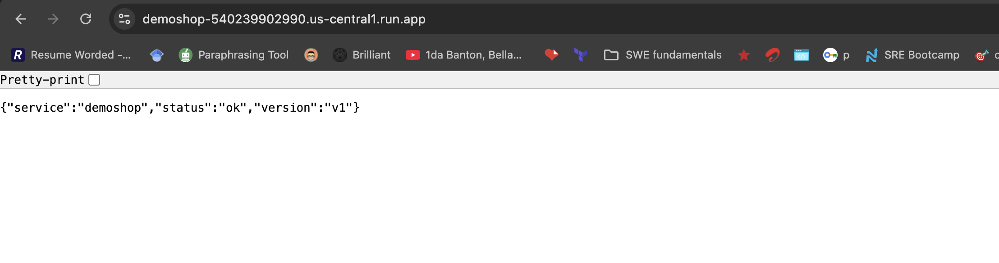
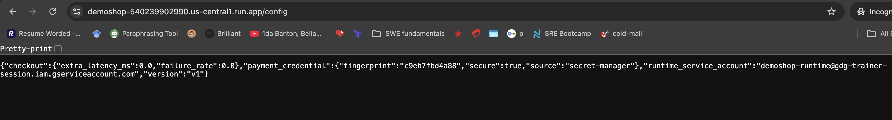
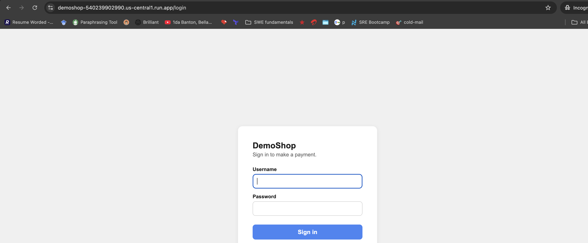
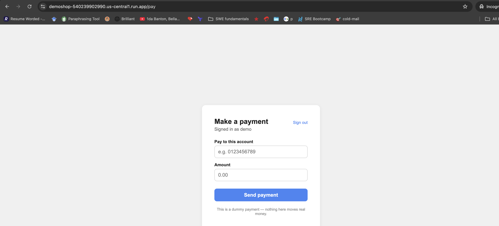
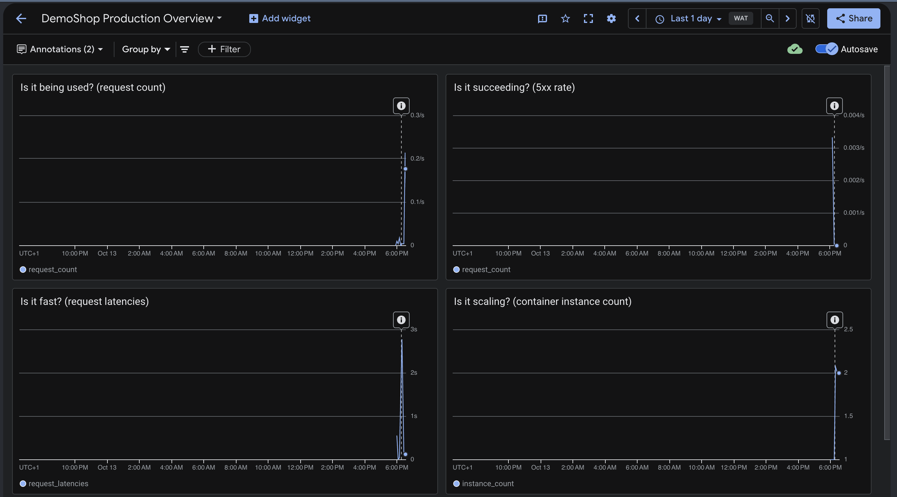

# DemoShop

The companion project for **"From Code to Production"** (DevFest Akure 2026), a hands-on workshop that builds a secure, observable golden path on Google Cloud.

DemoShop has a login page and a dummy "make a payment to this account" page Every part of it exists to answer one of the workshop's three production questions:

| Question | Where it lives |
|---|---|
| Can you ship it again? | `scripts/deploy.sh` (Part 1) |
| Is it allowed to do only what it needs? | `/config`, `scripts/setup_secret.sh` Identity and Secret Manager (Part 2) |
| Would you know before your customers did? | logs, `scripts/dashboard.json` — Observability (Part 3) |

Part 4 (the incident) and Part 5 (scaling) build on all three.

## Running the workshop

You need a GCP project with billing enabled and the `gcloud` CLI authenticated (`gcloud init`).

All scripts read `$PROJECT` from `gcloud config get-value project` and default `$REGION` to `us-central1`.

```bash
 gcloud auth login
 gcloud config set project PROJECT_ID
 #Enable the following APIs on the project PROJECT_ID: Secret Manager, IAM, and Cloud Run 
./scripts/deploy.sh          # Part 1 — ships the first revision
./scripts/setup_secret.sh    # Part 2 — secret, dedicated identity, scoped binding
./scripts/generate_traffic.sh 20   # warm the dashboard with a healthy baseline
gcloud monitoring dashboards create --config-from-file=scripts/dashboard.json
```

**During the session, in order:**

| Part | Script | What it shows |
|---|---|---|
| 1 — Ship it | `scripts/deploy.sh` | source -> container -> registry -> revision |
| 2 — Secure it | `scripts/setup_secret.sh` | dedicated service account, IAM binding scoped to the secret, NOT the project |
| 2 — tested | `scripts/revoke_access.sh` | removes the binding, watch `/config` and `/checkout` fail without a redeploy |
| 3 — Observe it | `scripts/generate_traffic.sh` | establishes the "before" on the dashboard |
| 4 — Break it | `scripts/break_production.sh` | injects the incident (`CHECKOUT_EXTRA_LATENCY_MS`, `CHECKOUT_FAILURE_RATE`) via `--update-env-vars` |
| 4 — Fix it | `scripts/rollback.sh` | routes traffic back to the last-known-good revision in seconds |

Teardown:

```bash
./scripts/cleanup.sh
```

## How the incident actually works

- `/checkout` reads `CHECKOUT_EXTRA_LATENCY_MS` and `CHECKOUT_FAILURE_RATE` from
the environment on every request.
- `break_production.sh` sets both via
`gcloud run services update --update-env-vars`.

The failure path also writes a structured JSON log line with
`"severity": "ERROR"` and the message `"Payment provider rejected the
charge"`.

### Routes

```bash
GET  /            machine health check
GET  /config      reports the runtime service account and where the payment credential came from
GET  /checkout    JSON API used by scripts/generate_traffic.sh and the incident drill
GET,POST /login     dummy sign-in page
GET,POST /pay       the "make a payment to this account" page a logged-in user sees
GET  /logout        clears the session
```

### Logging

Every request that matters writes one JSON line to stdout (or stderr for ERROR), with a `severity` field.
Cloud Logging parses that natively, so `severity>=ERROR` in Logs Explorer works with no extra configuration.

### Pictures










